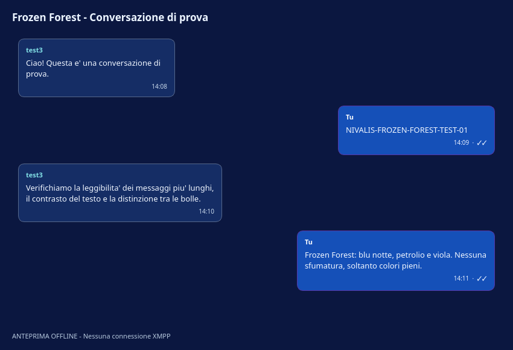

# Frozen Forest

**Original dark theme by Klod Cripta**

Frozen Forest is a flat, dark visual theme featuring midnight blue,
deep teal and violet accents.

Originally developed for **Nivalis - Open Source Messenger**,
a native GNU/Linux messaging application built with C++ and Qt6.

## Preview

Offline Qt Widgets preview using sample messages.

## Design philosophy

Frozen Forest combines a cold, nocturnal atmosphere with a clean
and functional user interface.

The theme emphasizes:

- Solid colors without gradients.
- Clear separation between interface sections.
- Readable text and balanced contrast.
- Violet accents for selected controls.
- Deep blue and teal backgrounds.

## Official color palette

| Color | Hex |
|---|---|
| Midnight | #0B1740 |
| Deep Blue | #152D65 |
| Glacier Blue | #1550B8 |
| Forest Violet | #5736A7 |
| Aurora Violet | #885BCA |
| Frost Gray | #55678B |
| Arctic Teal | #136B89 |
| Deep Teal | #07566A |
| Dark Forest | #092D3A |

Additional supporting colors are used for text, borders,
hover states and accessibility.

The machine-readable palette is available in palette.json.

## Project structure

    frozen-forest-theme/
        LICENSE
        README.md
        palette.json
        theme/
            FrozenForest.qss

## Usage with Qt

Frozen Forest is a Qt Widgets stylesheet (QSS).

The stylesheet was initially developed and visually tested
with Nivalis on GNU/Linux using Qt6.

It includes selectors specific to Nivalis widgets, such as
chatPanel, incomingBubble and outgoingBubble.

Other Qt applications may require modifications to these
selectors to reproduce the complete appearance.

Example for a Qt Widgets application:

    QFile file("FrozenForest.qss");

    if (file.open(QIODevice::ReadOnly | QIODevice::Text)) {
        qApp->setStyleSheet(QString::fromUtf8(file.readAll()));
    }

Include the appropriate Qt headers and adjust the file path
for your application.

## Status

**Version 0.3 - Development release candidate**

The theme has been visually tested in Nivalis and in a
standalone Qt Widgets conversation preview.

Compatibility testing across other applications and
desktop environments has not yet been completed.

## Credits

**Design and development: Klod Cripta**

Copyright (C) 2026 Klod Cripta.

## License

GNU General Public License, version 3 or later.

SPDX-License-Identifier: GPL-3.0-or-later

See LICENSE for the full license text.

## Related project

Frozen Forest was originally developed for
Nivalis - Open Source Messenger.

Nivalis and Frozen Forest are separate software projects.
